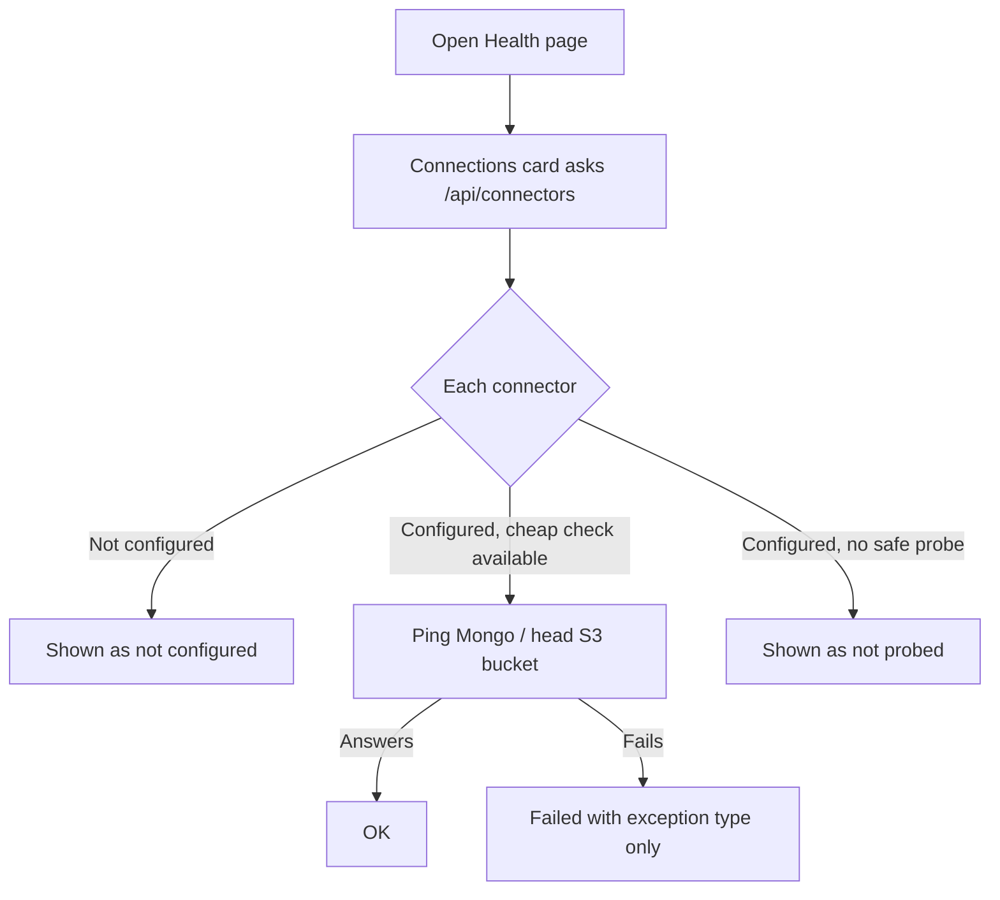
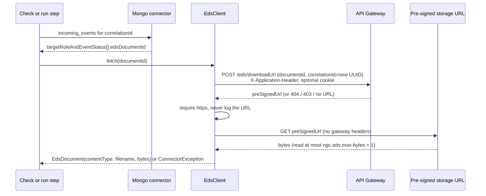

# Connectors

## Problem and current state
Corro Regression reads and writes several external systems: NGC's MongoDB, an S3 bucket, Kafka, and (new) EDS through the API Gateway. Each connection used to be built where it was first needed (`MongoConfig` in `collector`, `S3XmlStore` in `xml`, `KafkaEventPublisher` in `publisher`) and three classes each read `ngc.mongo.*` themselves. There was no way to fetch a stored document, which the PDF checks need.

Constraints:
- Everything except Kafka is read-only, and the tool must say so.
- The pre-signed download URL is a credential: never logged, never sent the gateway headers.
- More connectors will come, so adding one must not touch the others.
- QA PDFs contain customer data: nothing is committed, and local copies follow the retention settings.

## Layout
```
connector/
  Connector.java            id() + check(): what the Health page lists
  ConnectorException.java   kind: UNAVAILABLE | NOT_FOUND | DENIED | TOO_LARGE
  ConnectorController.java  GET /api/connectors
  mongo/   MongoConfig, MongoLimits, MongoDiagnostics, DatabaseReport, MongoConnector
  s3/      ObjectStore (readBytes, read), S3ObjectStore, S3Location
  eds/     EdsClient (fetch / resolveDownloadUrl / download), EdsDocument
  kafka/   EventPublisher, KafkaEventPublisher
```
Consumers (`MongoNgcDataSource`, `MongoHealthSource`, `MongoForensicsSource`, `XmlVerifier`, `RunExecutor`) keep their domain logic and depend on the connector types. Analysis of a fetched document is not a connector's job: it will live in a separate package and receive bytes.

The EDS client is a read-only port of the Explorer's `EdsDownloadUrlClient` (download only, none of its update, replace or delete calls). It is copied rather than shared because the two repos have separate stacks and release cycles; extract a library when a third consumer appears.

## Adding a connector
1. Create `connector/<system>/` with a client bean that is enabled only when its settings are present (`@ConditionalOnExpression`).
2. Implement `Connector` on the bean. `check()` must be cheap and read-only; return `NOT_PROBED` when the only honest check is a real call.
3. Add the id to `ConnectorController.KNOWN` and a row to the README table.
4. Map failures to `ConnectorException` kinds and keep secrets and driver messages out of them.

## User flow


## Fetching a document (used by the PDF checks that follow)


## Open points
- That `edsDocumentId` is the PDF Tango produced is inferred from NGC downloading PDFs from EDS before TIFF conversion; it has not been traced end to end. `EdsClientLiveTest` (set `API_GATEWAY_BASE_URL` and `EDS_LIVE_DOCUMENT_ID`) checks one real document starts with `%PDF-`.
- Whether `downloadUrl` needs the gateway cookie from this tool's network is unknown (`CORRO_GATEWAY_COOKIE` is supported).
- `API_GATEWAY_BASE_URL` is not tied to `NGC_ENVIRONMENT` by code; the Health card shows the gateway host so a mismatch is visible.
- Next phases, not in this change: fetch by correlationId through an API, store the bytes as a run-case artifact, then the PDF analysis and QA-defined constraints.
