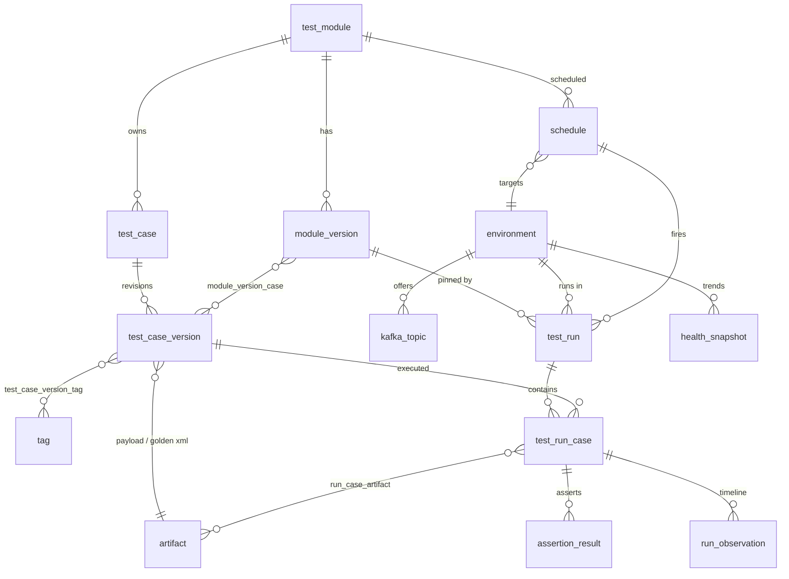

# Application schema (H2 now, Postgres-portable)

Migrations: `backend/src/main/resources/db/migration/` (`V1__schema.sql`, `V2__seed_reference.sql`). Secrets (Mongo URI, Kafka, AWS) stay in `.env`, never in the DB.



## Groups
- **Reference:** `tag` (category CLIENT/EVENT/MAPPER/PRIORITY/PATH, seeded; CRUD later), `environment`, `kafka_topic` (SOR `zinnia.correspondence.sor`, BPM `zinnia.correspondence.<env>`).
- **Authoring (immutable):** `test_module` → `module_version` (version_no, semver label, content_hash, status DRAFT/APPROVED/RELEASE_GATE/RETIRED, change_note). `test_case` is stable identity (`scenario_key`); `test_case_version` is one immutable revision. `module_version_case` links which revisions form a module version, so unchanged scenarios are shared between versions. Any edit = new `test_case_version` + new `module_version`; `content_hash` lets the service reject no-op saves.
- **Inputs:** `artifact` holds the tester-uploaded Kafka event JSON (`EVENT_PAYLOAD`) and golden XML; `storage=DB` for small inputs, `FILE` (path + sha256) for captured output.
- **Execution:** `schedule` → `test_run` (pins `module_version_id`, env, trigger, observed NGC/rule versions) → `test_run_case` (fresh `correlation_id`, resolved topic, status) → `assertion_result` (expected vs actual per path) and `run_observation` (ordered Kafka/Mongo/S3 timeline). Run-case artifacts: generated XML, CDS payload, snapshots.
- **Health/audit:** `health_snapshot` (stuck PROCESSING, failure rates, retry/dead-letter backlog, funnel) and `audit_log` (reference-data and version changes).

## `test_case_version.expected_json` shape
```json
{
  "incomingEvent": { "status": "SENT_TO_CDS" },
  "targets": [ { "role": "OWNER", "status": "SENT_TO_CDS", "deliveryType": "PRINT",
                 "emailNotification": "YES", "agentType": "PRIMARYSERVICINGAGENT", "documentType": "POLPG" } ],
  "xml": { "exists": true, "xsdValid": true, "goldenCompare": true, "ignore": ["timestamps"] },
  "cds": { "published": true, "count": 1, "fields": { "ClientCode": "GILI", "TargetPartyRole": "OWNER" } },
  "journey": ["requestValid", "requestStart", "requestSentToCDS"],
  "callbacks": ["pdf.generation.started", "pdf.generation.completed"],
  "noFailures": ["technical_failures", "dead_letter_events"]
}
```

## Correlation ID tracking (V3)
- Every run case gets a fresh **UUID v4** (NGC requires a UUID, so no text prefix). It is inserted into `test_run_case.correlation_id` (unique) **before** publish; `published_at`/partition/offset are set after the Kafka ack, so an id that was registered but never published is visible.
- The injector replaces **every occurrence** of the payload's original id (`source_correlation_id`), not only top-level `correlationid` (callbacks also echo it, e.g. in a `transactionId` identifier).
- All sightings are stored in `run_observation` keyed by `correlation_id`: NGC Mongo records and CDS callbacks (`pdf.generation.*`, `delivery.*`). Callback `identifiers` are captured as `ngc_unique_id`, `tango_job_id` (`JobId`), `role_tracking_id`, `original_target_event`.
- **Per-run rewrite process** (a tester may upload a payload with any correlationId, including a real one copied from QA): (1) at upload, parse `correlationid` and store it as `test_case_version.payload_correlation_id`; the uploaded payload is never modified. (2) At each run, generate a new UUID v4, register it, then copy the payload and replace every occurrence of the original id with the new one (top-level `correlationid`, plus any identifier/data fields that echo it). (3) Store the rewritten payload as `test_run_case.injected_payload_artifact_id`, then publish. (4) Guard: the run fails before publishing if the new id equals the original, or if the original id still appears in the injected payload. Also warn at upload if the id already exists in the target env's `incoming_events` (a copied real event).
- The registry (not a marker prefix) drives cleanup and "what did we create in QA" queries.

## Design notes
- Topic is mandatory per test case (`kafka_kind` + `kafka_topic_pattern`, `{env}` resolved at run time against `kafka_topic`).
- `test_run_case.correlation_id` is unique: every run injects a fresh marker-prefixed ID.
- Portable types only (no BLOB/CLOB; JSON as TEXT); verified to apply on H2 2.3 default and PostgreSQL mode.
- Open: whether `expected_json` should later be normalised into rows (kept as JSON now so assertion types can evolve without migrations).
